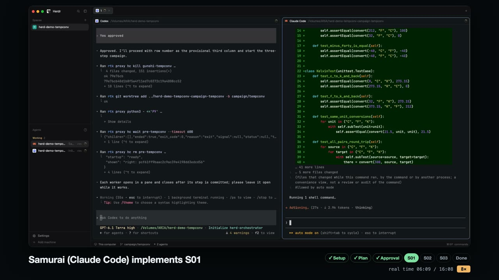

# Agent Skills

A collection of reusable skills for agent-assisted work. Each skill lives in its own directory under `skills/` and has a `SKILL.md` entry point.

## Catalog

| Skill | Purpose |
| --- | --- |
| [manual-orchestrator](skills/manual-orchestrator/SKILL.md) | Coordinate a staged objective across fresh chats, with user-carried prompts, evidence-based validation, and a local handover record. |
| [product-orchestrator](skills/product-orchestrator/SKILL.md) | Coordinate product work through EGM, UI Delivery with Stitch, implementation, and verification, with saved decisions and stage handoffs. |

## Install

Install skills for Codex, Claude Code, or another supported coding agent using the [skills CLI](https://github.com/vercel-labs/skills):

```bash
npx skills add blackform-labs/agent-skills
```

Select skills and agents when prompted. Installation is scoped to the current project by default. Add `-g` to install for your user across projects:

```bash
npx skills add blackform-labs/agent-skills -g
```

The CLI requires Node.js 22.20 or later. To list available skills without installing them, run `npx skills add blackform-labs/agent-skills --list`. Check for updates with `npx skills check` and update CLI-managed installations with `npx skills update`. Restart the agent or start a new session if a newly installed skill is not discovered.

**Codex alternative:** ask Codex to run `$skill-installer` for `https://github.com/blackform-labs/agent-skills/tree/main/skills/manual-orchestrator`. Skills installed this way are separate from CLI-managed installations and do not update automatically.

## Use manual-orchestrator

In an agent session where the skill is available, start the workflow with:

```text
init manual-orchestrator
```

Include your objective in the same message, or provide it when asked. This is a chat instruction, not a terminal command. You can also explicitly invoke the skill using your agent's supported syntax, such as `$manual-orchestrator init` in Codex or `/manual-orchestrator init` in Claude Code. The skill follows your language for conversation and the project record. All generated prompts are in English, including stage prompts, corrections, and handover prompts, even when you write in another language.

The orchestrator writes a project-local record and prepares one stage prompt at a time. You open each new worker session, run the prompt, and return its result to the orchestrator. Corrections stay in the same worker session. Validation distinguishes reported work, verified evidence, and human acceptance.

When the orchestrator chat gets long, ask it to prepare a handover:

```text
manual-orchestrator hand over
```

`manual-orchestrator handover` also works, as does invoking the skill with `hand over`. The orchestrator saves the current stage, pending results or decisions, and next action in the project record, then gives you a continuation prompt. Open a fresh orchestrator chat with access to the same project and paste that prompt. Continue returning worker results there; existing worker chats stay in use for corrections.

Orchestrator and worker sessions can use different CLIs. The skill uses a goal command such as `/goal` only when the worker interface is known to support it; otherwise it provides a normal prompt. Session renaming also depends on the interface. Agent support, skill discovery, and command availability vary by product and version.

If your agent does not support installing skills, you can copy the contents of [SKILL.md](skills/manual-orchestrator/SKILL.md) into a new session as instructions, followed by your objective. The session still needs suitable file access to maintain the project record.

## Use product-orchestrator

Start with an objective and a project directory:

```text
init product-orchestrator
```

The coordinator selects the stages the work needs, prepares one worker prompt at a time, and validates the returned results. You open the worker chats and carry their results back. It saves progress in an initiative-specific project record so another coordinator chat can resume. Use `product-orchestrator resume`, `product-orchestrator status`, or `product-orchestrator hand over` for continuation, status, or transfer to a fresh chat. These are chat instructions, not terminal commands.

The workflow can use EGM for concept and technical design, UI Delivery with Stitch for interface work, and suitable implementation and verification skills. It reuses applicable briefs and decisions, skips unnecessary stages, and keeps human decisions separate from technical checks. A change to an earlier input reopens the affected downstream work.

EGM, UI Delivery, and Stitch are separate dependencies, checked when their stage is needed. They are not installed by this skill. If an installed UI Delivery version lacks Stitch guidance, the coordinator includes that work in the stage prompt. The worker must have the required tools and inspect the generated designs. Missing capabilities are reported before dependent work continues.

Conversation and records follow your language; generated handoff prompts are in English and retain your artifact language preferences. This is a manual coordination workflow. It does not start background agents or launch chats. `manual-orchestrator` remains a separate skill with its existing workflow.

## Case study: herd-orchestrator (in development)

herd-orchestrator is a skill we are developing separately. It is not part of this repository and cannot be installed from it.

[](docs/media/herd-orchestrator-demo.mp4)

[Watch the 3-minute demo](docs/media/herd-orchestrator-demo.mp4). It is a 16-minute session sped up in the slow parts: picking the roles, cutting an eight-step plan to three, one approval, and three steps implemented and reviewed. The reviewer sent the second step back once before it passed.

The skill runs a development campaign through Herdr from a single brief. It asks once which CLI (Codex or Claude Code), model and effort each role uses: a planner (Gunshi), an implementer (Samurai) and a reviewer (Metsuke). The planner turns the brief into a spec, an architecture note and a step-by-step plan, and the person approves that plan once.

After approval, the campaign runs in its own Git worktree and branch. Each step gets a fresh implementer. The orchestrator runs the step's checks on the host and confirms the changes stay inside the step's paths, then a reviewer on a different model judges every acceptance criterion. A passing step is committed and the next one starts; a failing one goes back to the implementer.

The campaign stops only when it needs a person: plan approval, a gated step, a manual task, a worker waiting on a permission or question, or a step that runs out of retries. It never pushes or merges.

## Repository conventions

- Keep each skill self-contained in `skills/<skill-name>/`.
- Describe when a skill applies in its `SKILL.md` frontmatter.
- Add scripts, references, and assets only when the workflow needs them.
- Do not commit credentials, private project data, or generated orchestration records.
- Check third-party licensing and attribution before adding material created elsewhere.
